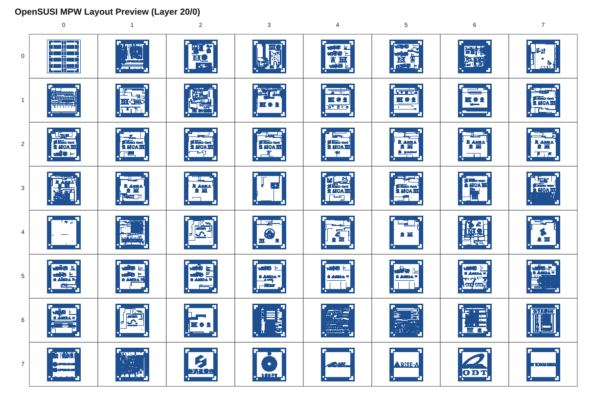

# OpenSUSI_MPW_TR2026
## OpenSUSI TR-1um MPW Project

## MPW Layout Overview

Below is the current user layout of the MPW shuttle.

### Interactive Layout (SVG)

Click each tile to open the corresponding Tapeout directory.




[View USERS.svg directly](https://raw.githubusercontent.com/H-Ojiro/OpenSUSI_MPW_TR2026/main/USERS.svg)

---
<table style="width: 100%; table-layout: fixed; border-collapse: collapse;">
  <thead>
    <tr>
      <th style="width: 44px;">&nbsp;</th>
      <th style="width: 12.50%; text-align: center;">0</th>
      <th style="width: 12.50%; text-align: center;">1</th>
      <th style="width: 12.50%; text-align: center;">2</th>
      <th style="width: 12.50%; text-align: center;">3</th>
      <th style="width: 12.50%; text-align: center;">4</th>
      <th style="width: 12.50%; text-align: center;">5</th>
      <th style="width: 12.50%; text-align: center;">6</th>
      <th style="width: 12.50%; text-align: center;">7</th>
    </tr>
  </thead>
  <tbody>
    <tr>
      <th scope="row" style="width: 44px; text-align: center;">0</th>
      <td style="padding: 6px; min-width: 90px; height: 90px; vertical-align: top; text-align: center;"><a href="https://github.com/H-Ojiro/OpenSUSI_MPW_TR2026/tree/main/users/000_system" style="display: block; color: inherit; text-decoration: none;"><strong>TEG</strong><br><small>tr_<wbr>1um_<wbr>000_<wbr>system_<wbr>teg</small><br><small>Run: -</small><br><small>Tile: (0,0)</small></a></td>
      <td style="padding: 6px; min-width: 90px; height: 90px; vertical-align: top; text-align: center;"><a href="https://github.com/jun1okamura/TR-1um_I2C_2026" style="display: block; color: inherit; text-decoration: none;"><strong>jun1okamura</strong><br><small>ORD_<wbr>260530_<wbr>005051_<wbr>01</small><br><small>Run: 35306341781</small><br><small>Tile: (1,0)</small></a></td>
      <td style="padding: 6px; min-width: 90px; height: 90px; vertical-align: top; text-align: center;"><a href="https://github.com/ishi-kai/ISHI-KAI_Multiple_Projects_OpenMPW_OpenSUSI-TR10-1_01" style="display: block; color: inherit; text-decoration: none;"><strong>ishi-kai</strong><br><small>ORD_<wbr>260530_<wbr>202824_<wbr>01</small><br><small>Run: 33083546018</small><br><small>Tile: (2,0)</small></a></td>
      <td style="padding: 6px; min-width: 90px; height: 90px; vertical-align: top; text-align: center;"><a href="https://github.com/ishi-kai/ISHI-KAI_Multiple_Projects_OpenMPW_OpenSUSI-TR10-1_02" style="display: block; color: inherit; text-decoration: none;"><strong>ishi-kai</strong><br><small>ORD_<wbr>260530_<wbr>202824_<wbr>02</small><br><small>Run: 34482670311</small><br><small>Tile: (3,0)</small></a></td>
      <td style="padding: 6px; min-width: 90px; height: 90px; vertical-align: top; text-align: center;"><a href="https://github.com/ishi-kai/ISHI-KAI_Multiple_Projects_OpenMPW_OpenSUSI-TR10-1_kyoto-ths_01" style="display: block; color: inherit; text-decoration: none;"><strong>ishi-kai</strong><br><small>ORD_<wbr>260605_<wbr>053628_<wbr>01</small><br><small>Run: 31565393934</small><br><small>Tile: (4,0)</small></a></td>
      <td style="padding: 6px; min-width: 90px; height: 90px; vertical-align: top; text-align: center;"><a href="https://github.com/ishi-kai/ISHI-KAI_Multiple_Projects_OpenMPW_OpenSUSI-TR10-1_kyoto-ths_02" style="display: block; color: inherit; text-decoration: none;"><strong>ishi-kai</strong><br><small>ORD_<wbr>260605_<wbr>053628_<wbr>02</small><br><small>Run: 34325227029</small><br><small>Tile: (5,0)</small></a></td>
      <td style="padding: 6px; min-width: 90px; height: 90px; vertical-align: top; text-align: center;"><a href="https://github.com/munetomo-maruyama/TR-1um_MPW_Sanken" style="display: block; color: inherit; text-decoration: none;"><strong>munetomo-maruyama</strong><br><small>ORD_<wbr>260706_<wbr>001837_<wbr>01</small><br><small>Run: 34696475834</small><br><small>Tile: (6,0)</small></a></td>
      <td style="padding: 6px; min-width: 90px; height: 90px; vertical-align: top; text-align: center;"><a href="https://github.com/FujimotoKuniaki/TR-1um_Seisho" style="display: block; color: inherit; text-decoration: none;"><strong>FujimotoKuniaki</strong><br><small>ORD_<wbr>260723_<wbr>215727_<wbr>01</small><br><small>Run: 35316081283</small><br><small>Tile: (7,0)</small></a></td>
    </tr>
    <tr>
      <th scope="row" style="width: 44px; text-align: center;">1</th>
      <td style="padding: 6px; min-width: 90px; height: 90px; vertical-align: top; text-align: center;"><a href="https://github.com/FujimotoKuniaki/TR-1um_TEST" style="display: block; color: inherit; text-decoration: none;"><strong>FujimotoKuniaki</strong><br><small>ORD_<wbr>260722_<wbr>033310_<wbr>01</small><br><small>Run: 35297966599</small><br><small>Tile: (0,1)</small></a></td>
      <td style="padding: 6px; min-width: 90px; height: 90px; vertical-align: top; text-align: center;"><a href="https://github.com/ishi-kai/ISHI-KAI_Multiple_Projects_OpenMPW_OpenSUSI-TR10-1_ZEP" style="display: block; color: inherit; text-decoration: none;"><strong>ishi-kai</strong><br><small>ORD_<wbr>260820_<wbr>054538_<wbr>01</small><br><small>Run: 32150856665</small><br><small>Tile: (1,1)</small></a></td>
      <td style="padding: 6px; min-width: 90px; height: 90px; vertical-align: top; text-align: center;"><a href="https://github.com/hironorimiura/OpenSUSI-TR1um-v2609" style="display: block; color: inherit; text-decoration: none;"><strong>hironorimiura</strong><br><small>ORD_<wbr>260614_<wbr>000834_<wbr>01</small><br><small>Run: 33346017556</small><br><small>Tile: (2,1)</small></a></td>
      <td style="padding: 6px; min-width: 90px; height: 90px; vertical-align: top; text-align: center;"><a href="https://github.com/ishi-kai/ISHI-KAI_Multiple_Projects_OpenMPW_OpenSUSI-TR10-1_Qdai_01" style="display: block; color: inherit; text-decoration: none;"><strong>ishi-kai</strong><br><small>ORD_<wbr>260729_<wbr>223912_<wbr>01</small><br><small>Run: 34326897996</small><br><small>Tile: (3,1)</small></a></td>
      <td style="padding: 6px; min-width: 90px; height: 90px; vertical-align: top; text-align: center;"><a href="https://github.com/ishi-kai/ISHI-KAI_Multiple_Projects_OpenMPW_OpenSUSI-TR10-1_Qdai_02" style="display: block; color: inherit; text-decoration: none;"><strong>ishi-kai</strong><br><small>ORD_<wbr>260729_<wbr>223937_<wbr>02</small><br><small>Run: 34326915912</small><br><small>Tile: (4,1)</small></a></td>
      <td style="padding: 6px; min-width: 90px; height: 90px; vertical-align: top; text-align: center;"><a href="https://github.com/ishi-kai/ISHI-KAI_Multiple_Projects_OpenMPW_OpenSUSI-TR10-1_Qdai_03" style="display: block; color: inherit; text-decoration: none;"><strong>ishi-kai</strong><br><small>ORD_<wbr>260729_<wbr>223937_<wbr>01</small><br><small>Run: 34328634920</small><br><small>Tile: (5,1)</small></a></td>
      <td style="padding: 6px; min-width: 90px; height: 90px; vertical-align: top; text-align: center;"><a href="https://github.com/ishi-kai/ISHI-KAI_Multiple_Projects_OpenMPW_OpenSUSI-TR10-1_Qdai_04" style="display: block; color: inherit; text-decoration: none;"><strong>ishi-kai</strong><br><small>ORD_<wbr>260729_<wbr>223845_<wbr>01</small><br><small>Run: 36204014796</small><br><small>Tile: (6,1)</small></a></td>
      <td style="padding: 6px; min-width: 90px; height: 90px; vertical-align: top; text-align: center;"><a href="https://github.com/ishi-kai/ISHI-KAI_Multiple_Projects_OpenMPW_OpenSUSI-TR10-1_SiCA_01" style="display: block; color: inherit; text-decoration: none;"><strong>ishi-kai</strong><br><small>ORD_<wbr>260828_<wbr>042453_<wbr>05</small><br><small>Run: 34771788182</small><br><small>Tile: (7,1)</small></a></td>
    </tr>
    <tr>
      <th scope="row" style="width: 44px; text-align: center;">2</th>
      <td style="padding: 6px; min-width: 90px; height: 90px; vertical-align: top; text-align: center;"><a href="https://github.com/ishi-kai/ISHI-KAI_Multiple_Projects_OpenMPW_OpenSUSI-TR10-1_SiCA_02" style="display: block; color: inherit; text-decoration: none;"><strong>ishi-kai</strong><br><small>ORD_<wbr>260828_<wbr>042453_<wbr>03</small><br><small>Run: 34772097251</small><br><small>Tile: (0,2)</small></a></td>
      <td style="padding: 6px; min-width: 90px; height: 90px; vertical-align: top; text-align: center;"><a href="https://github.com/ishi-kai/ISHI-KAI_Multiple_Projects_OpenMPW_OpenSUSI-TR10-1_SiCA_03" style="display: block; color: inherit; text-decoration: none;"><strong>ishi-kai</strong><br><small>ORD_<wbr>260828_<wbr>042453_<wbr>04</small><br><small>Run: 34799532594</small><br><small>Tile: (1,2)</small></a></td>
      <td style="padding: 6px; min-width: 90px; height: 90px; vertical-align: top; text-align: center;"><a href="https://github.com/ishi-kai/ISHI-KAI_Multiple_Projects_OpenMPW_OpenSUSI-TR10-1_SiCA_04" style="display: block; color: inherit; text-decoration: none;"><strong>ishi-kai</strong><br><small>ORD_<wbr>260828_<wbr>042453_<wbr>01</small><br><small>Run: 34772574202</small><br><small>Tile: (2,2)</small></a></td>
      <td style="padding: 6px; min-width: 90px; height: 90px; vertical-align: top; text-align: center;"><a href="https://github.com/ishi-kai/ISHI-KAI_Multiple_Projects_OpenMPW_OpenSUSI-TR10-1_SiCA_05" style="display: block; color: inherit; text-decoration: none;"><strong>ishi-kai</strong><br><small>ORD_<wbr>260828_<wbr>042453_<wbr>07</small><br><small>Run: 34772769865</small><br><small>Tile: (3,2)</small></a></td>
      <td style="padding: 6px; min-width: 90px; height: 90px; vertical-align: top; text-align: center;"><a href="https://github.com/ishi-kai/ISHI-KAI_Multiple_Projects_OpenMPW_OpenSUSI-TR10-1_SiCA_06" style="display: block; color: inherit; text-decoration: none;"><strong>ishi-kai</strong><br><small>ORD_<wbr>260828_<wbr>042453_<wbr>10</small><br><small>Run: 34772858533</small><br><small>Tile: (4,2)</small></a></td>
      <td style="padding: 6px; min-width: 90px; height: 90px; vertical-align: top; text-align: center;"><a href="https://github.com/ishi-kai/ISHI-KAI_Multiple_Projects_OpenMPW_OpenSUSI-TR10-1_ichiken_01" style="display: block; color: inherit; text-decoration: none;"><strong>ishi-kai</strong><br><small>ORD_<wbr>260722_<wbr>033159_<wbr>02</small><br><small>Run: 33945552963</small><br><small>Tile: (5,2)</small></a></td>
      <td style="padding: 6px; min-width: 90px; height: 90px; vertical-align: top; text-align: center;"><a href="https://github.com/ishi-kai/ISHI-KAI_Multiple_Projects_OpenMPW_OpenSUSI-TR10-1_ichiken_02" style="display: block; color: inherit; text-decoration: none;"><strong>ishi-kai</strong><br><small>ORD_<wbr>260722_<wbr>033159_<wbr>03</small><br><small>Run: 33945580757</small><br><small>Tile: (6,2)</small></a></td>
      <td style="padding: 6px; min-width: 90px; height: 90px; vertical-align: top; text-align: center;"><a href="https://github.com/ishi-kai/ISHI-KAI_Multiple_Projects_OpenMPW_OpenSUSI-TR10-1_ichiken_04" style="display: block; color: inherit; text-decoration: none;"><strong>ishi-kai</strong><br><small>ORD_<wbr>260722_<wbr>033159_<wbr>07</small><br><small>Run: 33945601929</small><br><small>Tile: (7,2)</small></a></td>
    </tr>
    <tr>
      <th scope="row" style="width: 44px; text-align: center;">3</th>
      <td style="padding: 6px; min-width: 90px; height: 90px; vertical-align: top; text-align: center;"><a href="https://github.com/ishi-kai/ISHI-KAI_Multiple_Projects_OpenMPW_OpenSUSI-TR10-1_ichiken_05" style="display: block; color: inherit; text-decoration: none;"><strong>ishi-kai</strong><br><small>ORD_<wbr>260722_<wbr>033159_<wbr>01</small><br><small>Run: 34483204402</small><br><small>Tile: (0,3)</small></a></td>
      <td style="padding: 6px; min-width: 90px; height: 90px; vertical-align: top; text-align: center;"><a href="https://github.com/ishi-kai/ISHI-KAI_Multiple_Projects_OpenMPW_OpenSUSI-TR10-1_ichiken_06" style="display: block; color: inherit; text-decoration: none;"><strong>ishi-kai</strong><br><small>ORD_<wbr>260722_<wbr>033159_<wbr>05</small><br><small>Run: 34467156026</small><br><small>Tile: (1,3)</small></a></td>
      <td style="padding: 6px; min-width: 90px; height: 90px; vertical-align: top; text-align: center;"><a href="https://github.com/ishi-kai/ISHI-KAI_Multiple_Projects_OpenMPW_OpenSUSI-TR10-1_ichiken_03" style="display: block; color: inherit; text-decoration: none;"><strong>ishi-kai</strong><br><small>ORD_<wbr>260722_<wbr>033159_<wbr>10</small><br><small>Run: 34464259817</small><br><small>Tile: (2,3)</small></a></td>
      <td style="padding: 6px; min-width: 90px; height: 90px; vertical-align: top; text-align: center;"><a href="https://github.com/yanai-takamasa/TR-1um_HHTT2602" style="display: block; color: inherit; text-decoration: none;"><strong>yanai-takamasa</strong><br><small>ORD_<wbr>260601_<wbr>062822_<wbr>01</small><br><small>Run: 34923184876</small><br><small>Tile: (3,3)</small></a></td>
      <td style="padding: 6px; min-width: 90px; height: 90px; vertical-align: top; text-align: center;"><a href="https://github.com/ishi-kai/ISHI-KAI_Multiple_Projects_OpenMPW_OpenSUSI-TR10-1_SiCA_07" style="display: block; color: inherit; text-decoration: none;"><strong>ishi-kai</strong><br><small>ORD_<wbr>260828_<wbr>042453_<wbr>08</small><br><small>Run: 35141558933</small><br><small>Tile: (4,3)</small></a></td>
      <td style="padding: 6px; min-width: 90px; height: 90px; vertical-align: top; text-align: center;"><a href="https://github.com/ishi-kai/ISHI-KAI_Multiple_Projects_OpenMPW_OpenSUSI-TR10-1_SiCA_08" style="display: block; color: inherit; text-decoration: none;"><strong>ishi-kai</strong><br><small>ORD_<wbr>260828_<wbr>042453_<wbr>09</small><br><small>Run: 34773145930</small><br><small>Tile: (5,3)</small></a></td>
      <td style="padding: 6px; min-width: 90px; height: 90px; vertical-align: top; text-align: center;"><a href="https://github.com/ishi-kai/ISHI-KAI_Multiple_Projects_OpenMPW_OpenSUSI-TR10-1_SiCA_09" style="display: block; color: inherit; text-decoration: none;"><strong>ishi-kai</strong><br><small>ORD_<wbr>260828_<wbr>042453_<wbr>06</small><br><small>Run: 34773622856</small><br><small>Tile: (6,3)</small></a></td>
      <td style="padding: 6px; min-width: 90px; height: 90px; vertical-align: top; text-align: center;"><a href="https://github.com/ishi-kai/ISHI-KAI_Multiple_Projects_OpenMPW_OpenSUSI-TR10-1_SiCA_10" style="display: block; color: inherit; text-decoration: none;"><strong>ishi-kai</strong><br><small>ORD_<wbr>260828_<wbr>042453_<wbr>02</small><br><small>Run: 36232441877</small><br><small>Tile: (7,3)</small></a></td>
    </tr>
    <tr>
      <th scope="row" style="width: 44px; text-align: center;">4</th>
      <td style="padding: 6px; min-width: 90px; height: 90px; vertical-align: top; text-align: center;"><a href="https://github.com/AriyoshiNaoki1016jp/TR-1um_AriyoshiNaoki1016jp" style="display: block; color: inherit; text-decoration: none;"><strong>AriyoshiNaoki1016jp</strong><br><small>ORD_<wbr>260914_<wbr>001657_<wbr>01</small><br><small>Run: 35062556632</small><br><small>Tile: (0,4)</small></a></td>
      <td style="padding: 6px; min-width: 90px; height: 90px; vertical-align: top; text-align: center;"><a href="https://github.com/regymm/TrialDesign-TR-1um_MPW" style="display: block; color: inherit; text-decoration: none;"><strong>regymm</strong><br><small>ORD_<wbr>260914_<wbr>001614_<wbr>01</small><br><small>Run: 34970013106</small><br><small>Tile: (1,4)</small></a></td>
      <td style="padding: 6px; min-width: 90px; height: 90px; vertical-align: top; text-align: center;"><a href="https://github.com/1016330-Z100/TR-1um_ai_icc2" style="display: block; color: inherit; text-decoration: none;"><strong>1016330-Z100</strong><br><small>ORD_<wbr>260807_<wbr>052146_<wbr>02</small><br><small>Run: 35216228826</small><br><small>Tile: (2,4)</small></a></td>
      <td style="padding: 6px; min-width: 90px; height: 90px; vertical-align: top; text-align: center;"><a href="https://github.com/ishi-kai/ISHI-KAI_Multiple_Projects_OpenMPW_OpenSUSI-TR10-1_GunmaKosen" style="display: block; color: inherit; text-decoration: none;"><strong>ishi-kai</strong><br><small>ORD_<wbr>260914_<wbr>044849_<wbr>01</small><br><small>Run: 35514716675</small><br><small>Tile: (3,4)</small></a></td>
      <td style="padding: 6px; min-width: 90px; height: 90px; vertical-align: top; text-align: center;"><a href="https://github.com/ishi-kai/ISHI-KAI_Multiple_Projects_OpenMPW_OpenSUSI-TR10-1_Kosen01" style="display: block; color: inherit; text-decoration: none;"><strong>ishi-kai</strong><br><small>ORD_<wbr>260904_<wbr>061755_<wbr>01</small><br><small>Run: 35957748295</small><br><small>Tile: (4,4)</small></a></td>
      <td style="padding: 6px; min-width: 90px; height: 90px; vertical-align: top; text-align: center;"><a href="https://github.com/ishi-kai/ISHI-KAI_Multiple_Projects_OpenMPW_OpenSUSI-TR10-1_Kosen03" style="display: block; color: inherit; text-decoration: none;"><strong>ishi-kai</strong><br><small>ORD_<wbr>260904_<wbr>061755_<wbr>03</small><br><small>Run: 35514283173</small><br><small>Tile: (5,4)</small></a></td>
      <td style="padding: 6px; min-width: 90px; height: 90px; vertical-align: top; text-align: center;"><a href="https://github.com/ishi-kai/ISHI-KAI_Multiple_Projects_OpenMPW_OpenSUSI-TR10-1_Kosen04" style="display: block; color: inherit; text-decoration: none;"><strong>ishi-kai</strong><br><small>ORD_<wbr>260904_<wbr>060922_<wbr>01</small><br><small>Run: 35674080705</small><br><small>Tile: (6,4)</small></a></td>
      <td style="padding: 6px; min-width: 90px; height: 90px; vertical-align: top; text-align: center;"><a href="https://github.com/ishi-kai/ISHI-KAI_Multiple_Projects_OpenMPW_OpenSUSI-TR10-1_Kosen02" style="display: block; color: inherit; text-decoration: none;"><strong>ishi-kai</strong><br><small>ORD_<wbr>260904_<wbr>061755_<wbr>02</small><br><small>Run: 35514897461</small><br><small>Tile: (7,4)</small></a></td>
    </tr>
    <tr>
      <th scope="row" style="width: 44px; text-align: center;">5</th>
      <td style="padding: 6px; min-width: 90px; height: 90px; vertical-align: top; text-align: center;"><a href="https://github.com/ishi-kai/ISHI-KAI_Multiple_Projects_OpenMPW_OpenSUSI-TR10-1_AUDIO_OPAMP01" style="display: block; color: inherit; text-decoration: none;"><strong>ishi-kai</strong><br><small>ORD_<wbr>260722_<wbr>033159_<wbr>06</small><br><small>Run: 35925808428</small><br><small>Tile: (0,5)</small></a></td>
      <td style="padding: 6px; min-width: 90px; height: 90px; vertical-align: top; text-align: center;"><a href="https://github.com/ishi-kai/ISHI-KAI_Multiple_Projects_OpenMPW_OpenSUSI-TR10-1_AUDIO_OPAMP02" style="display: block; color: inherit; text-decoration: none;"><strong>ishi-kai</strong><br><small>ORD_<wbr>260722_<wbr>033159_<wbr>08</small><br><small>Run: 35831506997</small><br><small>Tile: (1,5)</small></a></td>
      <td style="padding: 6px; min-width: 90px; height: 90px; vertical-align: top; text-align: center;"><a href="https://github.com/ishi-kai/ISHI-KAI_Multiple_Projects_OpenMPW_OpenSUSI-TR10-1_AUDIO_OPAMP03" style="display: block; color: inherit; text-decoration: none;"><strong>ishi-kai</strong><br><small>ORD_<wbr>260722_<wbr>033159_<wbr>09</small><br><small>Run: 35831959452</small><br><small>Tile: (2,5)</small></a></td>
      <td style="padding: 6px; min-width: 90px; height: 90px; vertical-align: top; text-align: center;"><a href="https://github.com/ishi-kai/ISHI-KAI_Multiple_Projects_OpenMPW_OpenSUSI-TR10-1_AUDIO_OPAMP04" style="display: block; color: inherit; text-decoration: none;"><strong>ishi-kai</strong><br><small>ORD_<wbr>260722_<wbr>033159_<wbr>04</small><br><small>Run: 36117294970</small><br><small>Tile: (3,5)</small></a></td>
      <td style="padding: 6px; min-width: 90px; height: 90px; vertical-align: top; text-align: center;"><a href="https://github.com/ishi-kai/ISHI-KAI_Multiple_Projects_OpenMPW_OpenSUSI-TR10-1_AUDIO_OPAMP05" style="display: block; color: inherit; text-decoration: none;"><strong>ishi-kai</strong><br><small>ORD_<wbr>260915_<wbr>060134_<wbr>01</small><br><small>Run: 35841185386</small><br><small>Tile: (4,5)</small></a></td>
      <td style="padding: 6px; min-width: 90px; height: 90px; vertical-align: top; text-align: center;"><a href="https://github.com/ishi-kai/ISHI-KAI_Multiple_Projects_OpenMPW_OpenSUSI-TR10-1_AUDIO_OPAMP06" style="display: block; color: inherit; text-decoration: none;"><strong>ishi-kai</strong><br><small>ORD_<wbr>260915_<wbr>060134_<wbr>02</small><br><small>Run: 35844444013</small><br><small>Tile: (5,5)</small></a></td>
      <td style="padding: 6px; min-width: 90px; height: 90px; vertical-align: top; text-align: center;"><a href="https://github.com/ishi-kai/ISHI-KAI_Multiple_Projects_OpenMPW_OpenSUSI-TR10-1_AUDIO_OPAMP07" style="display: block; color: inherit; text-decoration: none;"><strong>ishi-kai</strong><br><small>ORD_<wbr>260915_<wbr>060134_<wbr>03</small><br><small>Run: 36155164962</small><br><small>Tile: (6,5)</small></a></td>
      <td style="padding: 6px; min-width: 90px; height: 90px; vertical-align: top; text-align: center;"><a href="https://github.com/ishi-kai/ISHI-KAI_Multiple_Projects_OpenMPW_OpenSUSI-TR10-1_AUDIO_OPAMP08" style="display: block; color: inherit; text-decoration: none;"><strong>ishi-kai</strong><br><small>ORD_<wbr>260915_<wbr>060134_<wbr>04</small><br><small>Run: 36015076362</small><br><small>Tile: (7,5)</small></a></td>
    </tr>
    <tr>
      <th scope="row" style="width: 44px; text-align: center;">6</th>
      <td style="padding: 6px; min-width: 90px; height: 90px; vertical-align: top; text-align: center;"><a href="https://github.com/ishi-kai/ISHI-KAI_Multiple_Projects_OpenMPW_OpenSUSI-TR10-1_AUDIO_OPAMP09" style="display: block; color: inherit; text-decoration: none;"><strong>ishi-kai</strong><br><small>ORD_<wbr>260915_<wbr>060134_<wbr>05</small><br><small>Run: 36059579650</small><br><small>Tile: (0,6)</small></a></td>
      <td style="padding: 6px; min-width: 90px; height: 90px; vertical-align: top; text-align: center;"><a href="https://github.com/1016330-Z100/TR-1um_ai_icc1" style="display: block; color: inherit; text-decoration: none;"><strong>1016330-Z100</strong><br><small>ORD_<wbr>260807_<wbr>052146_<wbr>01</small><br><small>Run: 35293475698</small><br><small>Tile: (1,6)</small></a></td>
      <td style="padding: 6px; min-width: 90px; height: 90px; vertical-align: top; text-align: center;"><a href="https://github.com/ishi-kai/ISHI-KAI_Multiple_Projects_OpenMPW_OpenSUSI-TR10-1_OpenSUSI01" style="display: block; color: inherit; text-decoration: none;"><strong>ishi-kai</strong><br><small>ORD_<wbr>260918_<wbr>052358_<wbr>01</small><br><small>Run: 35324661608</small><br><small>Tile: (2,6)</small></a></td>
      <td style="padding: 6px; min-width: 90px; height: 90px; vertical-align: top; text-align: center;"><a href="https://github.com/ishi-kai/ISHI-KAI_Multiple_Projects_OpenMPW_OpenSUSI-TR10-1_OpenSUSI02" style="display: block; color: inherit; text-decoration: none;"><strong>ishi-kai</strong><br><small>ORD_<wbr>260918_<wbr>052358_<wbr>02</small><br><small>Run: 35325332472</small><br><small>Tile: (3,6)</small></a></td>
      <td style="padding: 6px; min-width: 90px; height: 90px; vertical-align: top; text-align: center;"><a href="https://github.com/ishi-kai/ISHI-KAI_Multiple_Projects_OpenMPW_OpenSUSI-TR10-1_OpenSUSI04" style="display: block; color: inherit; text-decoration: none;"><strong>ishi-kai</strong><br><small>ORD_<wbr>260918_<wbr>052358_<wbr>04</small><br><small>Run: 35449109235</small><br><small>Tile: (4,6)</small></a></td>
      <td style="padding: 6px; min-width: 90px; height: 90px; vertical-align: top; text-align: center;"><a href="https://github.com/ishi-kai/ISHI-KAI_Multiple_Projects_OpenMPW_OpenSUSI-TR10-1_OpenSUSI05" style="display: block; color: inherit; text-decoration: none;"><strong>ishi-kai</strong><br><small>ORD_<wbr>260918_<wbr>052358_<wbr>05</small><br><small>Run: 36151945471</small><br><small>Tile: (5,6)</small></a></td>
      <td style="padding: 6px; min-width: 90px; height: 90px; vertical-align: top; text-align: center;"><a href="https://github.com/ishi-kai/ISHI-KAI_Multiple_Projects_OpenMPW_OpenSUSI-TR10-1_OpenSUSI03" style="display: block; color: inherit; text-decoration: none;"><strong>ishi-kai</strong><br><small>ORD_<wbr>260918_<wbr>052358_<wbr>03</small><br><small>Run: 35407253075</small><br><small>Tile: (6,6)</small></a></td>
      <td style="padding: 6px; min-width: 90px; height: 90px; vertical-align: top; text-align: center;"><a href="https://github.com/TAKE-HooJoo/TR-1um_MPW_project" style="display: block; color: inherit; text-decoration: none;"><strong>TAKE-HooJoo</strong><br><small>ORD_<wbr>260918_<wbr>085720_<wbr>03</small><br><small>Run: 35861760234</small><br><small>Tile: (7,6)</small></a></td>
    </tr>
    <tr>
      <th scope="row" style="width: 44px; text-align: center;">7</th>
      <td style="padding: 6px; min-width: 90px; height: 90px; vertical-align: top; text-align: center;"><a href="https://github.com/jun1okamura/TR-1um_SCLK_SPI" style="display: block; color: inherit; text-decoration: none;"><strong>jun1okamura</strong><br><small>ORD_<wbr>260918_<wbr>052420_<wbr>01</small><br><small>Run: 35321483805</small><br><small>Tile: (0,7)</small></a></td>
      <td style="padding: 6px; min-width: 90px; height: 90px; vertical-align: top; text-align: center;"><a href="https://github.com/jun1okamura/TR-1um_TD4" style="display: block; color: inherit; text-decoration: none;"><strong>jun1okamura</strong><br><small>ORD_<wbr>260918_<wbr>052420_<wbr>02</small><br><small>Run: 35322598355</small><br><small>Tile: (1,7)</small></a></td>
      <td style="padding: 6px; min-width: 90px; height: 90px; vertical-align: top; text-align: center;"><a href="https://github.com/OpenSUSI/TR-1um_LOGO_METI" style="display: block; color: inherit; text-decoration: none;"><strong>OpenSUSI</strong><br><small>ORD_<wbr>260918_<wbr>085720_<wbr>01</small><br><small>Run: 35409262486</small><br><small>Tile: (2,7)</small></a></td>
      <td style="padding: 6px; min-width: 90px; height: 90px; vertical-align: top; text-align: center;"><a href="https://github.com/OpenSUSI/TR-1um_LOGO_MEXT" style="display: block; color: inherit; text-decoration: none;"><strong>OpenSUSI</strong><br><small>ORD_<wbr>260918_<wbr>085720_<wbr>04</small><br><small>Run: 35409270681</small><br><small>Tile: (3,7)</small></a></td>
      <td style="padding: 6px; min-width: 90px; height: 90px; vertical-align: top; text-align: center;"><a href="https://github.com/OpenSUSI/TR-1um_LOGO_AISol" style="display: block; color: inherit; text-decoration: none;"><strong>OpenSUSI</strong><br><small>ORD_<wbr>260918_<wbr>085720_<wbr>05</small><br><small>Run: 35409252880</small><br><small>Tile: (4,7)</small></a></td>
      <td style="padding: 6px; min-width: 90px; height: 90px; vertical-align: top; text-align: center;"><a href="https://github.com/OpenSUSI/TR-1um_LOGO_RISEA" style="display: block; color: inherit; text-decoration: none;"><strong>OpenSUSI</strong><br><small>ORD_<wbr>260918_<wbr>085720_<wbr>02</small><br><small>Run: 35409290113</small><br><small>Tile: (5,7)</small></a></td>
      <td style="padding: 6px; min-width: 90px; height: 90px; vertical-align: top; text-align: center;"><a href="https://github.com/OpenSUSI/TR-1um_LOGO_ODT" style="display: block; color: inherit; text-decoration: none;"><strong>OpenSUSI</strong><br><small>ORD_<wbr>260918_<wbr>085720_<wbr>06</small><br><small>Run: 35409280398</small><br><small>Tile: (6,7)</small></a></td>
      <td style="padding: 6px; min-width: 90px; height: 90px; vertical-align: top; text-align: center;"><a href="https://github.com/OpenSUSI/TR-1um_LOGO_TR" style="display: block; color: inherit; text-decoration: none;"><strong>OpenSUSI</strong><br><small>ORD_<wbr>260918_<wbr>085720_<wbr>07</small><br><small>Run: 35409298722</small><br><small>Tile: (7,7)</small></a></td>
    </tr>
  </tbody>
</table>
---

### Users List

Detailed table view:

👉 [USERS.md](./USERS.md)

---

## 📂 Repository Structure

```
