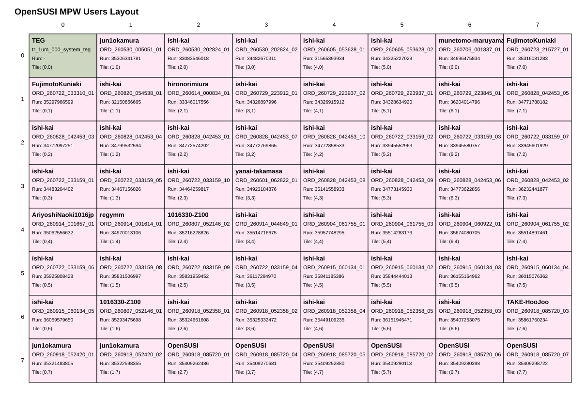

# OpenSUSI_MPW_TR2026
## OpenSUSI TR-1um MPW Project

## MPW Layout Overview

Below is the current user layout of the MPW shuttle.

### Interactive Layout (SVG)

Click each tile to open the corresponding Tapeout directory.

---
<table>
  <thead>
    <tr>
      <th></th>
      <th>0</th>
      <th>1</th>
      <th>2</th>
      <th>3</th>
      <th>4</th>
      <th>5</th>
      <th>6</th>
      <th>7</th>
    </tr>
  </thead>
  <tbody>
    <tr>
      <th scope="row">0</th>
      <td><strong><a href="https://github.com/H-Ojiro/OpenSUSI_MPW_TR2026/tree/main/users/000_system">TEG</a></strong></td>
      <td><strong><a href="https://github.com/H-Ojiro/OpenSUSI_MPW_TR2026/tree/main/users/jun1okamura/ORD-260530-005051-01">jun1okamura</a></strong></td>
      <td><strong><a href="https://github.com/H-Ojiro/OpenSUSI_MPW_TR2026/tree/main/users/ishi-kai/ORD-260530-202824-01">ishi-kai</a></strong></td>
      <td><strong><a href="https://github.com/H-Ojiro/OpenSUSI_MPW_TR2026/tree/main/users/ishi-kai/ORD-260530-202824-02">ishi-kai</a></strong></td>
      <td><strong><a href="https://github.com/H-Ojiro/OpenSUSI_MPW_TR2026/tree/main/users/ishi-kai/ORD-260605-053628-01">ishi-kai</a></strong></td>
      <td><strong><a href="https://github.com/H-Ojiro/OpenSUSI_MPW_TR2026/tree/main/users/ishi-kai/ORD-260605-053628-02">ishi-kai</a></strong></td>
      <td><strong><a href="https://github.com/H-Ojiro/OpenSUSI_MPW_TR2026/tree/main/users/munetomo-maruyama/ORD-260706-001837-01">munetomo-maruyama</a></strong></td>
      <td><strong><a href="https://github.com/H-Ojiro/OpenSUSI_MPW_TR2026/tree/main/users/FujimotoKuniaki/ORD-260723-215727-01">FujimotoKuniaki</a></strong></td>
    </tr>
    <tr>
      <th scope="row">1</th>
      <td><strong><a href="https://github.com/H-Ojiro/OpenSUSI_MPW_TR2026/tree/main/users/FujimotoKuniaki/ORD-260722-033310-01">FujimotoKuniaki</a></strong></td>
      <td><strong><a href="https://github.com/H-Ojiro/OpenSUSI_MPW_TR2026/tree/main/users/ishi-kai/ORD-260820-054538-01">ishi-kai</a></strong></td>
      <td><strong><a href="https://github.com/H-Ojiro/OpenSUSI_MPW_TR2026/tree/main/users/hironorimiura/ORD-260614-000834-01">hironorimiura</a></strong></td>
      <td><strong><a href="https://github.com/H-Ojiro/OpenSUSI_MPW_TR2026/tree/main/users/ishi-kai/ORD-260729-223912-01">ishi-kai</a></strong></td>
      <td><strong><a href="https://github.com/H-Ojiro/OpenSUSI_MPW_TR2026/tree/main/users/ishi-kai/ORD-260729-223937-02">ishi-kai</a></strong></td>
      <td><strong><a href="https://github.com/H-Ojiro/OpenSUSI_MPW_TR2026/tree/main/users/ishi-kai/ORD-260729-223937-01">ishi-kai</a></strong></td>
      <td><strong><a href="https://github.com/H-Ojiro/OpenSUSI_MPW_TR2026/tree/main/users/ishi-kai/ORD-260729-223845-01">ishi-kai</a></strong></td>
      <td><strong><a href="https://github.com/H-Ojiro/OpenSUSI_MPW_TR2026/tree/main/users/ishi-kai/ORD-260828-042453-05">ishi-kai</a></strong></td>
    </tr>
    <tr>
      <th scope="row">2</th>
      <td><strong><a href="https://github.com/H-Ojiro/OpenSUSI_MPW_TR2026/tree/main/users/ishi-kai/ORD-260828-042453-03">ishi-kai</a></strong></td>
      <td><strong><a href="https://github.com/H-Ojiro/OpenSUSI_MPW_TR2026/tree/main/users/ishi-kai/ORD-260828-042453-04">ishi-kai</a></strong></td>
      <td><strong><a href="https://github.com/H-Ojiro/OpenSUSI_MPW_TR2026/tree/main/users/ishi-kai/ORD-260828-042453-01">ishi-kai</a></strong></td>
      <td><strong><a href="https://github.com/H-Ojiro/OpenSUSI_MPW_TR2026/tree/main/users/ishi-kai/ORD-260828-042453-07">ishi-kai</a></strong></td>
      <td><strong><a href="https://github.com/H-Ojiro/OpenSUSI_MPW_TR2026/tree/main/users/ishi-kai/ORD-260828-042453-10">ishi-kai</a></strong></td>
      <td><strong><a href="https://github.com/H-Ojiro/OpenSUSI_MPW_TR2026/tree/main/users/ishi-kai/ORD-260722-033159-02">ishi-kai</a></strong></td>
      <td><strong><a href="https://github.com/H-Ojiro/OpenSUSI_MPW_TR2026/tree/main/users/ishi-kai/ORD-260722-033159-03">ishi-kai</a></strong></td>
      <td><strong><a href="https://github.com/H-Ojiro/OpenSUSI_MPW_TR2026/tree/main/users/ishi-kai/ORD-260722-033159-07">ishi-kai</a></strong></td>
    </tr>
    <tr>
      <th scope="row">3</th>
      <td><strong><a href="https://github.com/H-Ojiro/OpenSUSI_MPW_TR2026/tree/main/users/ishi-kai/ORD-260722-033159-01">ishi-kai</a></strong></td>
      <td><strong><a href="https://github.com/H-Ojiro/OpenSUSI_MPW_TR2026/tree/main/users/ishi-kai/ORD-260722-033159-05">ishi-kai</a></strong></td>
      <td><strong><a href="https://github.com/H-Ojiro/OpenSUSI_MPW_TR2026/tree/main/users/ishi-kai/ORD-260722-033159-10">ishi-kai</a></strong></td>
      <td><strong><a href="https://github.com/H-Ojiro/OpenSUSI_MPW_TR2026/tree/main/users/yanai-takamasa/ORD-260601-062822-01">yanai-takamasa</a></strong></td>
      <td><strong><a href="https://github.com/H-Ojiro/OpenSUSI_MPW_TR2026/tree/main/users/ishi-kai/ORD-260828-042453-08">ishi-kai</a></strong></td>
      <td><strong><a href="https://github.com/H-Ojiro/OpenSUSI_MPW_TR2026/tree/main/users/ishi-kai/ORD-260828-042453-09">ishi-kai</a></strong></td>
      <td><strong><a href="https://github.com/H-Ojiro/OpenSUSI_MPW_TR2026/tree/main/users/ishi-kai/ORD-260828-042453-06">ishi-kai</a></strong></td>
      <td><strong><a href="https://github.com/H-Ojiro/OpenSUSI_MPW_TR2026/tree/main/users/ishi-kai/ORD-260828-042453-02">ishi-kai</a></strong></td>
    </tr>
    <tr>
      <th scope="row">4</th>
      <td><strong><a href="https://github.com/H-Ojiro/OpenSUSI_MPW_TR2026/tree/main/users/AriyoshiNaoki1016jp/ORD-260914-001657-01">AriyoshiNaoki1016jp</a></strong></td>
      <td><strong><a href="https://github.com/H-Ojiro/OpenSUSI_MPW_TR2026/tree/main/users/regymm/ORD-260914-001614-01">regymm</a></strong></td>
      <td><strong><a href="https://github.com/H-Ojiro/OpenSUSI_MPW_TR2026/tree/main/users/1016330-Z100/ORD-260807-052146-02">1016330-Z100</a></strong></td>
      <td><strong><a href="https://github.com/H-Ojiro/OpenSUSI_MPW_TR2026/tree/main/users/ishi-kai/ORD-260914-044849-01">ishi-kai</a></strong></td>
      <td><strong><a href="https://github.com/H-Ojiro/OpenSUSI_MPW_TR2026/tree/main/users/ishi-kai/ORD-260904-061755-01">ishi-kai</a></strong></td>
      <td><strong><a href="https://github.com/H-Ojiro/OpenSUSI_MPW_TR2026/tree/main/users/ishi-kai/ORD-260904-061755-03">ishi-kai</a></strong></td>
      <td><strong><a href="https://github.com/H-Ojiro/OpenSUSI_MPW_TR2026/tree/main/users/ishi-kai/ORD-260904-060922-01">ishi-kai</a></strong></td>
      <td><strong><a href="https://github.com/H-Ojiro/OpenSUSI_MPW_TR2026/tree/main/users/ishi-kai/ORD-260904-061755-02">ishi-kai</a></strong></td>
    </tr>
    <tr>
      <th scope="row">5</th>
      <td><strong><a href="https://github.com/H-Ojiro/OpenSUSI_MPW_TR2026/tree/main/users/ishi-kai/ORD-260722-033159-06">ishi-kai</a></strong></td>
      <td><strong><a href="https://github.com/H-Ojiro/OpenSUSI_MPW_TR2026/tree/main/users/ishi-kai/ORD-260722-033159-08">ishi-kai</a></strong></td>
      <td><strong><a href="https://github.com/H-Ojiro/OpenSUSI_MPW_TR2026/tree/main/users/ishi-kai/ORD-260722-033159-09">ishi-kai</a></strong></td>
      <td><strong><a href="https://github.com/H-Ojiro/OpenSUSI_MPW_TR2026/tree/main/users/ishi-kai/ORD-260722-033159-04">ishi-kai</a></strong></td>
      <td><strong><a href="https://github.com/H-Ojiro/OpenSUSI_MPW_TR2026/tree/main/users/ishi-kai/ORD-260915-060134-01">ishi-kai</a></strong></td>
      <td><strong><a href="https://github.com/H-Ojiro/OpenSUSI_MPW_TR2026/tree/main/users/ishi-kai/ORD-260915-060134-02">ishi-kai</a></strong></td>
      <td><strong><a href="https://github.com/H-Ojiro/OpenSUSI_MPW_TR2026/tree/main/users/ishi-kai/ORD-260915-060134-03">ishi-kai</a></strong></td>
      <td><strong><a href="https://github.com/H-Ojiro/OpenSUSI_MPW_TR2026/tree/main/users/ishi-kai/ORD-260915-060134-04">ishi-kai</a></strong></td>
    </tr>
    <tr>
      <th scope="row">6</th>
      <td><strong><a href="https://github.com/H-Ojiro/OpenSUSI_MPW_TR2026/tree/main/users/ishi-kai/ORD-260915-060134-05">ishi-kai</a></strong></td>
      <td><strong><a href="https://github.com/H-Ojiro/OpenSUSI_MPW_TR2026/tree/main/users/1016330-Z100/ORD-260807-052146-01">1016330-Z100</a></strong></td>
      <td><strong><a href="https://github.com/H-Ojiro/OpenSUSI_MPW_TR2026/tree/main/users/ishi-kai/ORD-260918-052358-01">ishi-kai</a></strong></td>
      <td><strong><a href="https://github.com/H-Ojiro/OpenSUSI_MPW_TR2026/tree/main/users/ishi-kai/ORD-260918-052358-02">ishi-kai</a></strong></td>
      <td><strong><a href="https://github.com/H-Ojiro/OpenSUSI_MPW_TR2026/tree/main/users/ishi-kai/ORD-260918-052358-04">ishi-kai</a></strong></td>
      <td><strong><a href="https://github.com/H-Ojiro/OpenSUSI_MPW_TR2026/tree/main/users/ishi-kai/ORD-260918-052358-05">ishi-kai</a></strong></td>
      <td><strong><a href="https://github.com/H-Ojiro/OpenSUSI_MPW_TR2026/tree/main/users/ishi-kai/ORD-260918-052358-03">ishi-kai</a></strong></td>
      <td><strong><a href="https://github.com/H-Ojiro/OpenSUSI_MPW_TR2026/tree/main/users/TAKE-HooJoo/ORD-260918-085720-03">TAKE-HooJoo</a></strong></td>
    </tr>
    <tr>
      <th scope="row">7</th>
      <td><strong><a href="https://github.com/H-Ojiro/OpenSUSI_MPW_TR2026/tree/main/users/jun1okamura/ORD-260918-052420-01">jun1okamura</a></strong></td>
      <td><strong><a href="https://github.com/H-Ojiro/OpenSUSI_MPW_TR2026/tree/main/users/jun1okamura/ORD-260918-052420-02">jun1okamura</a></strong></td>
      <td><strong><a href="https://github.com/H-Ojiro/OpenSUSI_MPW_TR2026/tree/main/users/OpenSUSI/ORD-260918-085720-01">OpenSUSI</a></strong></td>
      <td><strong><a href="https://github.com/H-Ojiro/OpenSUSI_MPW_TR2026/tree/main/users/OpenSUSI/ORD-260918-085720-04">OpenSUSI</a></strong></td>
      <td><strong><a href="https://github.com/H-Ojiro/OpenSUSI_MPW_TR2026/tree/main/users/OpenSUSI/ORD-260918-085720-05">OpenSUSI</a></strong></td>
      <td><strong><a href="https://github.com/H-Ojiro/OpenSUSI_MPW_TR2026/tree/main/users/OpenSUSI/ORD-260918-085720-02">OpenSUSI</a></strong></td>
      <td><strong><a href="https://github.com/H-Ojiro/OpenSUSI_MPW_TR2026/tree/main/users/OpenSUSI/ORD-260918-085720-06">OpenSUSI</a></strong></td>
      <td><strong><a href="https://github.com/H-Ojiro/OpenSUSI_MPW_TR2026/tree/main/users/OpenSUSI/ORD-260918-085720-07">OpenSUSI</a></strong></td>
    </tr>
  </tbody>
</table>
---

### Users List

Detailed table view:

👉 [USERS.md](./USERS.md)

---

## 📂 Repository Structure
